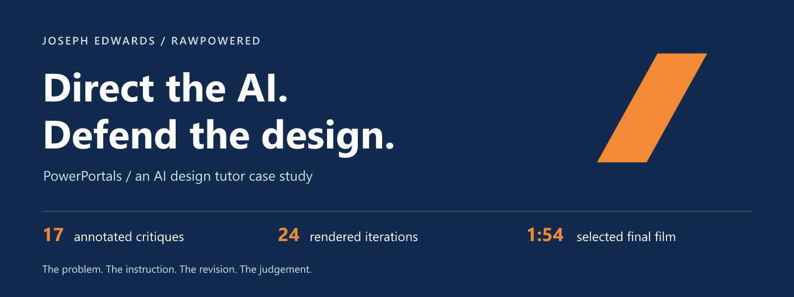
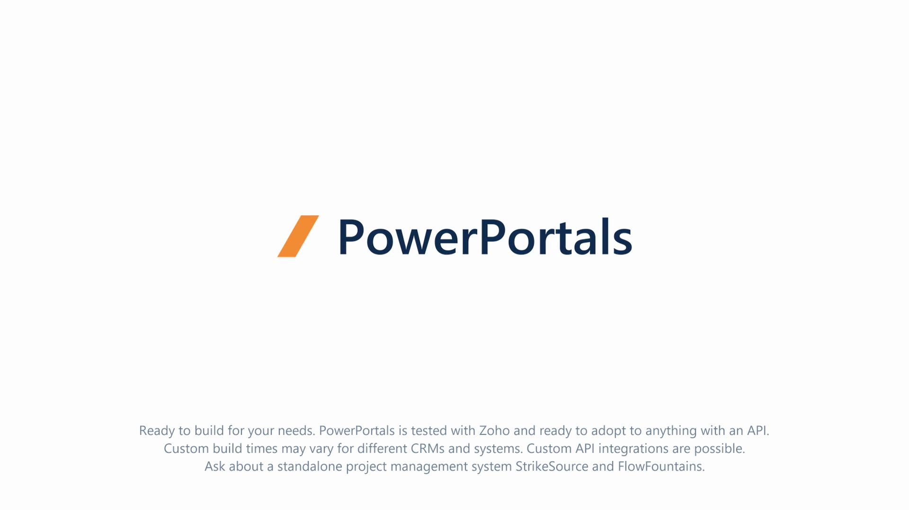
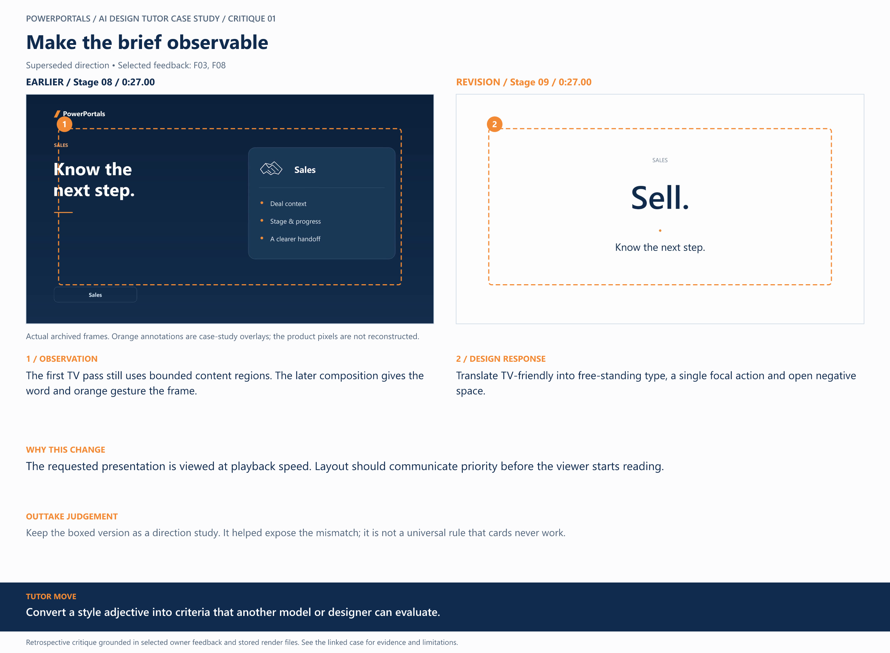
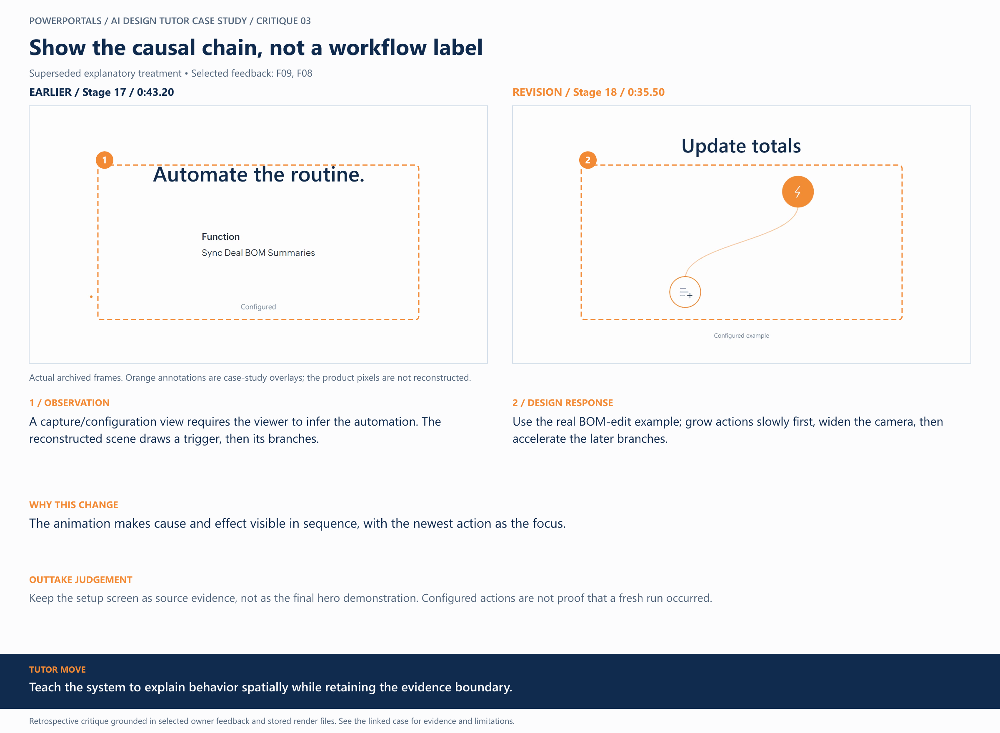
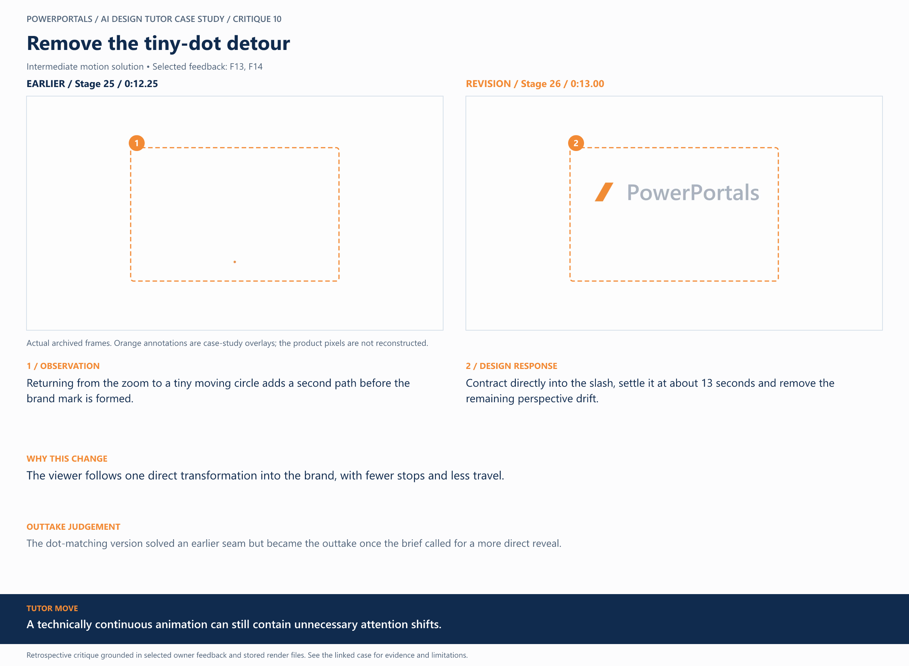
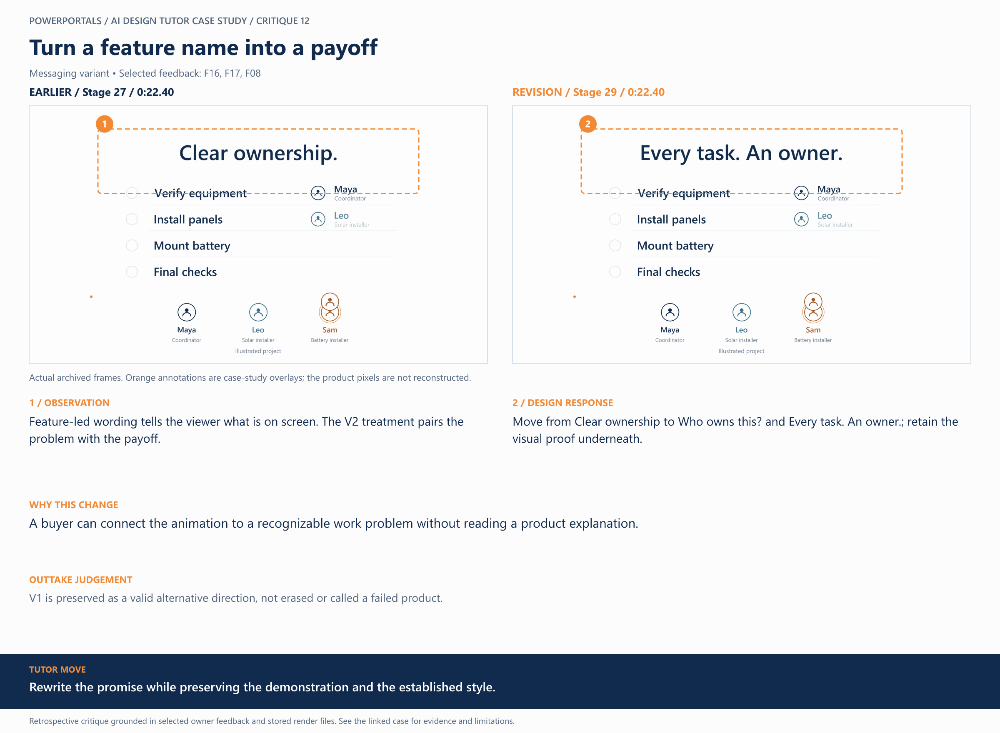

<p align="center">
  
</p>

<p align="center">
  <strong>Human creative direction · AI-assisted production · Evidence you can inspect</strong><br>
  A complex contractor-workflow platform, shaped into a focused visual story.
</p>

<p align="center">
  <a href="media/versions/31.mp4"><strong>Watch the final film</strong></a> &nbsp; / &nbsp;
  <a href="docs/critique-index.md"><strong>Explore 17 critiques</strong></a> &nbsp; / &nbsp;
  <a href="docs/case-study.md"><strong>Read the case study</strong></a>
</p>

---

## The finished presentation

**PowerPortals brings project work, material costs, automation and customer communication into one connected story.** The design challenge was to make that value understandable at playback speed: few words, visible behavior and purposeful transitions.

[](media/versions/31.mp4)

<p align="center">
  <strong>1:54 · 1920 × 1080 · 60fps · Original music &amp; individual effects</strong><br>
  <a href="media/versions/31.mp4">Open or download the complete final MP4</a> ·
  <a href="media/versions/04.mp4">Compare the 28-second early animatic</a>
</p>

*The preview above links to the actual film. GitHub may offer the MP4 as a download. The [showcase page source](index.html) includes embedded players and interactive concept studies; it can be viewed locally using the instructions below.*

## The process, made visible

The important work was deciding **what to change, why it mattered and what to preserve**. Each critique connects the feedback to authentic render frames, a specific revision and a reason the earlier treatment was superseded or retained.

| 35 documented stages | 24 rendered iterations | 17 critique studies |
|:---:|:---:|:---:|
| From brief and captures to final edit | Historical export identities preserved | Before/after frames, direction and trade-offs |
| [Follow the timeline](docs/process-timeline.md) | [Inspect the stage ledger](evidence/stage-ledger.json) | [Browse the collection](docs/critique-index.md) |

### Four decisions that shaped the result

| **01 / Give the idea room** | **03 / Show what happens** |
|:---|:---|
| [](docs/critiques/01.md) | [](docs/critiques/03.md) |
| **Problem:** The layout still felt boxed.<br>**Direction:** Large type, open space and one focal accent.<br>[Read the composition decision →](docs/critiques/01.md) | **Problem:** A label left the behavior unexplained.<br>**Direction:** Start with a trigger, then build the branches.<br>[Read the automation decision →](docs/critiques/03.md) |
| **10 / Remove the motion detour** | **12 / Lead with the buyer’s payoff** |
| [](docs/critiques/10.md) | [](docs/critiques/12.md) |
| **Problem:** A matched transition still took too much travel.<br>**Direction:** Contract directly into the destination slash.<br>[Read the continuity decision →](docs/critiques/10.md) | **Problem:** Feature names described screens rather than value.<br>**Direction:** “Who owns this?” → “Every task. An owner.”<br>[Read the messaging decision →](docs/critiques/12.md) |

**[Explore all 17 annotated studies →](docs/critique-index.md)**

### See the decisions move

| Trigger → actions | Circle → brand slash |
|:---:|:---:|
|  |  |
| Reveal cause and effect in sequence. | Keep one focal object and a direct destination. |

These are silent excerpts from original rendered versions. [Industry flips](assets/motion/industry-flips.gif), [completion handoff](assets/motion/completion-handoff.gif) and multi-phase strips provide further motion evidence. A still or phase strip alone does not establish playback timing.

## My contribution

**Joseph Edwards / RawPowered — creative direction and evaluation.** I defined the buyer and message, reviewed successive outputs, chose the visual direction, supplied the music, and turned broad reactions into bounded instructions about timing, alignment, motion and demonstration accuracy.

**AI assistance — production and documentation.** The assistant supported storyboarding, animation and layout implementation, media processing, rendering, verification and retrospective case-study assembly.

The reusable review loop:

**Observe → Diagnose → Specify → Compare → Verify → Explain the trade-off.**

| What to explore | What it demonstrates |
|---|---|
| [AI design-tutor method](docs/design-tutor-method.md) | Turning a critique into a teachable, reviewable instruction |
| [Feedback patterns](docs/feedback-patterns.md) | Moving from “make it smoother” to precise motion and timing constraints |
| [Case study](docs/case-study.md) | The brief, audience, creative decisions, result and limitations |
| [Two-minute reviewer guide](docs/reviewer-guide.md) | A short route through the strongest evidence |

## Evidence you can check

The public selection includes **two original MP4s, 17 critique boards, 34 source-frame extracts and four silent motion excerpts**. The boards use retrospective annotations on authentic archived frames. Selected feedback is transcribed from the project conversation; it is not a complete timestamped chat export.

- **[Media identities](evidence/public-asset-manifest.json):** SHA-256 checksums for the selected assets.
- **[Final export record](docs/publish-final-render.md):** Exact file identity, runtime, resolution and publication status.
- **[Publication check](evidence/publication-verification.json):** Link, media identity, frame-provenance and audio-policy checks.
- **[Evidence and attribution](docs/evidence-and-attribution.md):** What was recorded, illustrated and verified.

Some product scenes use illustrative tasks, fictional people and an unsent reply. This portfolio demonstrates design judgement and implementation checks; it does not claim measured sales uplift, independent viewer testing or universal CRM/API compatibility. The full production archive and account records remain private.

## View the interactive showcase locally

Open [index.html](index.html) from a downloaded copy, or run this command in the repository folder and visit `http://localhost:8000`:

```bash
python -m http.server 8000
```

The page includes the final film, early animatic, all 17 critique boards, silent motion previews and four clearly labeled interactive reconstructions. No build or external service is required.

---

<p align="center">
  <strong>AI-assisted production. Human-directed judgement.</strong><br>
  © 2026 RawPowered · <a href="RIGHTS.md">Rights &amp; publication policy</a>
</p>

The owner authorizes public display of the finished videos with synchronized music. Standalone music files are excluded. Public availability does not grant a license to extract, reuse or redistribute the soundtrack or project assets.
