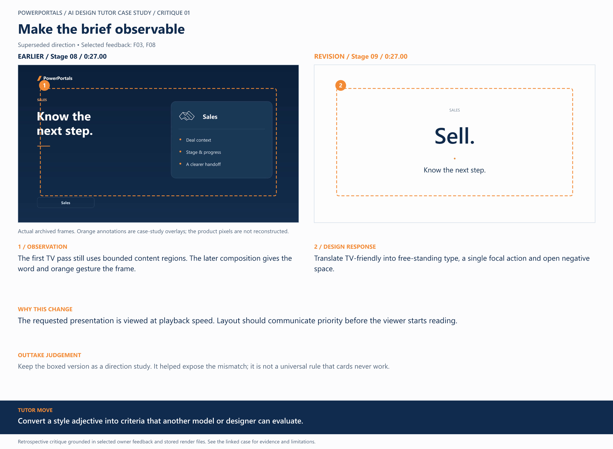

# 01 / Make the brief observable

**Earlier treatment:** Superseded direction. **Review type:** retrospective design critique.

| Source | Earlier | Revision |
|---|---|---|
| Stage | 08 | 09 |
| Frame time | 0:27.00 | 0:27.00 |
| Unannotated frame | [View](../../assets/frames/01-before.jpg) | [View](../../assets/frames/01-after.jpg) |
| Extraction provenance | [Record](../../assets/frames/01-before.jpg.json) | [Record](../../assets/frames/01-after.jpg.json) |

## The feedback

> TV commercials do not use boxed/block displays. They put things front and center with animations and transitions

— F03, selected project-owner feedback

> We also need to never show a wall of text to read, keep it TV friendly, big focus, only a few words at a time

— F08, selected project-owner feedback

## The judgement

**Observation:** The first TV pass still uses bounded content regions. The later composition gives the word and orange gesture the frame.

**Instruction:** Translate TV-friendly into free-standing type, a single focal action and open negative space.

**Why:** The requested presentation is viewed at playback speed. Layout should communicate priority before the viewer starts reading.

**Why the earlier treatment was superseded or retained:** Keep the boxed version as a direction study. It helped expose the mismatch; it is not a universal rule that cards never work.

## What this teaches

Convert a style adjective into criteria that another model or designer can evaluate.

This is evidence of a design decision and its resulting artifact. It is not a measured conversion, comprehension or product-compatibility result. The analysis was written after production; the source frames are authentic archived extracts. Motion and sound require playback evidence rather than a still alone.

[All critiques](../critique-index.md) · [Showcase overview](../../README.md)
