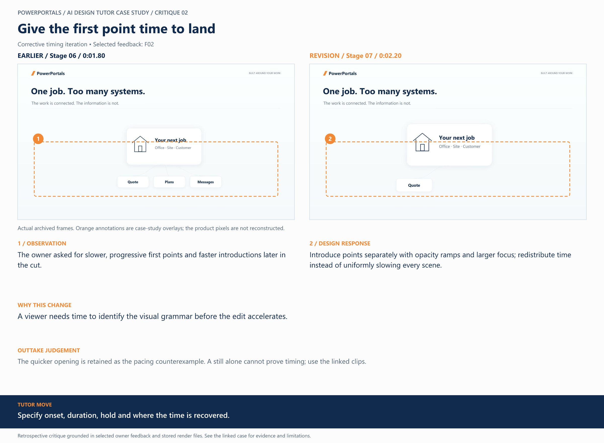

# 02 / Give the first point time to land

**Earlier treatment:** Corrective timing iteration. **Review type:** retrospective design critique.

| Source | Earlier | Revision |
|---|---|---|
| Stage | 06 | 07 |
| Frame time | 0:01.80 | 0:02.20 |
| Unannotated frame | [View](../../assets/frames/02-before.jpg) | [View](../../assets/frames/02-after.jpg) |
| Extraction provenance | [Record](../../assets/frames/02-before.jpg.json) | [Record](../../assets/frames/02-after.jpg.json) |

## The feedback

> The first features that are displayed need time to appear on screen in a similar way, slowed down and go from invisible to visible per point.

— F02, selected project-owner feedback

## The judgement

**Observation:** The owner asked for slower, progressive first points and faster introductions later in the cut.

**Instruction:** Introduce points separately with opacity ramps and larger focus; redistribute time instead of uniformly slowing every scene.

**Why:** A viewer needs time to identify the visual grammar before the edit accelerates.

**Why the earlier treatment was superseded or retained:** The quicker opening is retained as the pacing counterexample. A still alone cannot prove timing; use the linked clips.

## What this teaches

Specify onset, duration, hold and where the time is recovered.

This is evidence of a design decision and its resulting artifact. It is not a measured conversion, comprehension or product-compatibility result. The analysis was written after production; the source frames are authentic archived extracts. Motion and sound require playback evidence rather than a still alone.

[All critiques](../critique-index.md) · [Showcase overview](../../README.md)
