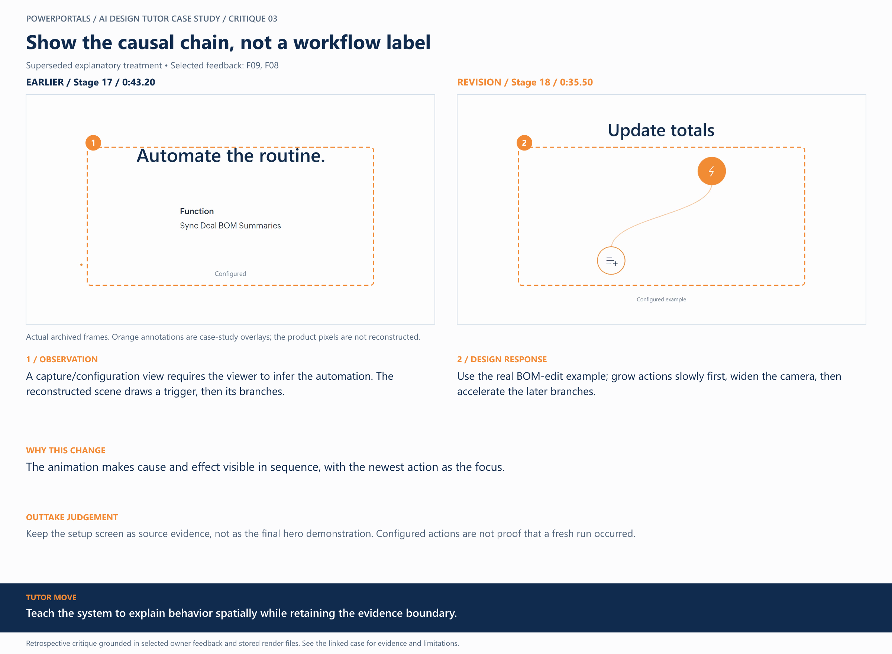

# 03 / Show the causal chain, not a workflow label

**Earlier treatment:** Superseded explanatory treatment. **Review type:** retrospective design critique.

| Source | Earlier | Revision |
|---|---|---|
| Stage | 17 | 18 |
| Frame time | 0:43.20 | 0:35.50 |
| Unannotated frame | [View](../../assets/frames/03-before.jpg) | [View](../../assets/frames/03-after.jpg) |
| Extraction provenance | [Record](../../assets/frames/03-before.jpg.json) | [Record](../../assets/frames/03-after.jpg.json) |

## The feedback

> have it start with the Trigger (use a real example), and then zoom out as you add branches

— F09, selected project-owner feedback

> We also need to never show a wall of text to read, keep it TV friendly, big focus, only a few words at a time

— F08, selected project-owner feedback

## The judgement

**Observation:** A capture/configuration view requires the viewer to infer the automation. The reconstructed scene draws a trigger, then its branches.

**Instruction:** Use the real BOM-edit example; grow actions slowly first, widen the camera, then accelerate the later branches.

**Why:** The animation makes cause and effect visible in sequence, with the newest action as the focus.

**Why the earlier treatment was superseded or retained:** Keep the setup screen as source evidence, not as the final hero demonstration. Configured actions are not proof that a fresh run occurred.

## What this teaches

Teach the system to explain behavior spatially while retaining the evidence boundary.

This is evidence of a design decision and its resulting artifact. It is not a measured conversion, comprehension or product-compatibility result. The analysis was written after production; the source frames are authentic archived extracts. Motion and sound require playback evidence rather than a still alone.

Silent, reduced-size excerpt extracted from the archived render.

[All critiques](../critique-index.md) · [Showcase overview](../../README.md)
