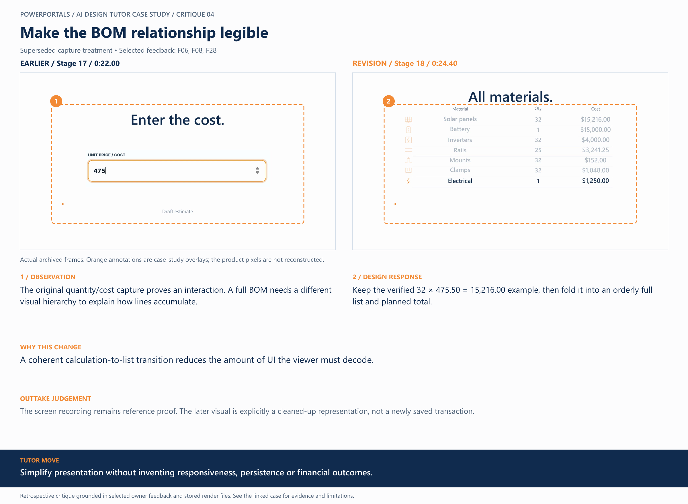

# 04 / Make the BOM relationship legible

**Earlier treatment:** Superseded capture treatment. **Review type:** retrospective design critique.

| Source | Earlier | Revision |
|---|---|---|
| Stage | 17 | 18 |
| Frame time | 0:22.00 | 0:24.40 |
| Unannotated frame | [View](../../assets/frames/04-before.jpg) | [View](../../assets/frames/04-after.jpg) |
| Extraction provenance | [Record](../../assets/frames/04-before.jpg.json) | [Record](../../assets/frames/04-after.jpg.json) |

## The feedback

> I'd like the money to be typed in from blank to value placed, and scrolling

— F06, selected project-owner feedback

> We also need to never show a wall of text to read, keep it TV friendly, big focus, only a few words at a time

— F08, selected project-owner feedback

> I want the same kind of approach for things like filling out cost and showing expense. That can become 1 slide to allow more time for showing animation of the full BOM.

— F28, selected project-owner feedback

## The judgement

**Observation:** The original quantity/cost capture proves an interaction. A full BOM needs a different visual hierarchy to explain how lines accumulate.

**Instruction:** Keep the verified 32 × 475.50 = 15,216.00 example, then fold it into an orderly full list and planned total.

**Why:** A coherent calculation-to-list transition reduces the amount of UI the viewer must decode.

**Why the earlier treatment was superseded or retained:** The screen recording remains reference proof. The later visual is explicitly a cleaned-up representation, not a newly saved transaction.

## What this teaches

Simplify presentation without inventing responsiveness, persistence or financial outcomes.

This is evidence of a design decision and its resulting artifact. It is not a measured conversion, comprehension or product-compatibility result. The analysis was written after production; the source frames are authentic archived extracts. Motion and sound require playback evidence rather than a still alone.

[All critiques](../critique-index.md) · [Showcase overview](../../README.md)
