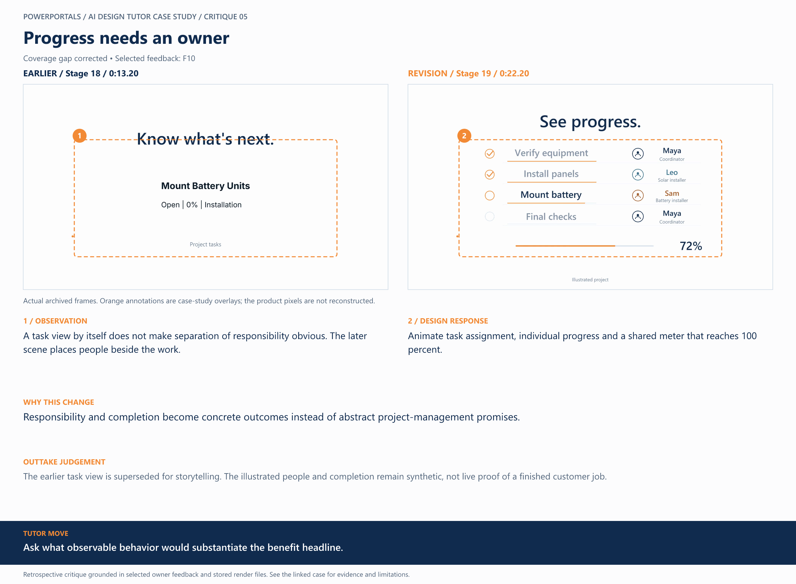

# 05 / Progress needs an owner

**Earlier treatment:** Coverage gap corrected. **Review type:** retrospective design critique.

| Source | Earlier | Revision |
|---|---|---|
| Stage | 18 | 19 |
| Frame time | 0:13.20 | 0:22.20 |
| Unannotated frame | [View](../../assets/frames/05-before.jpg) | [View](../../assets/frames/05-after.jpg) |
| Extraction provenance | [Record](../../assets/frames/05-before.jpg.json) | [Record](../../assets/frames/05-after.jpg.json) |

## The feedback

> it would also be good to show people getting assigned to tasks visually, so it shows that ownership is controllable and communicates clear separation of responsibilities.

— F10, selected project-owner feedback

## The judgement

**Observation:** A task view by itself does not make separation of responsibility obvious. The later scene places people beside the work.

**Instruction:** Animate task assignment, individual progress and a shared meter that reaches 100 percent.

**Why:** Responsibility and completion become concrete outcomes instead of abstract project-management promises.

**Why the earlier treatment was superseded or retained:** The earlier task view is superseded for storytelling. The illustrated people and completion remain synthetic, not live proof of a finished customer job.

## What this teaches

Ask what observable behavior would substantiate the benefit headline.

This is evidence of a design decision and its resulting artifact. It is not a measured conversion, comprehension or product-compatibility result. The analysis was written after production; the source frames are authentic archived extracts. Motion and sound require playback evidence rather than a still alone.

[All critiques](../critique-index.md) · [Showcase overview](../../README.md)
