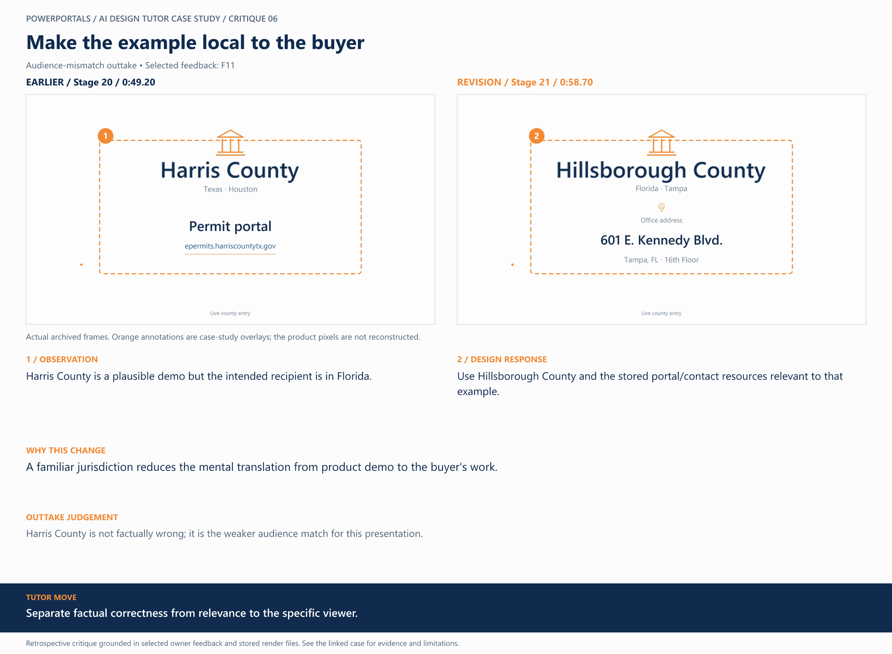

# 06 / Make the example local to the buyer

**Earlier treatment:** Audience-mismatch outtake. **Review type:** retrospective design critique.

| Source | Earlier | Revision |
|---|---|---|
| Stage | 20 | 21 |
| Frame time | 0:49.20 | 0:58.70 |
| Unannotated frame | [View](../../assets/frames/06-before.jpg) | [View](../../assets/frames/06-after.jpg) |
| Extraction provenance | [Record](../../assets/frames/06-before.jpg.json) | [Record](../../assets/frames/06-after.jpg.json) |

## The feedback

> the person I am presenting to will be in Florida. We can use a Florida county we can better showcase. Hillsborough County is the easiest and most recognizable example.

— F11, selected project-owner feedback

## The judgement

**Observation:** Harris County is a plausible demo but the intended recipient is in Florida.

**Instruction:** Use Hillsborough County and the stored portal/contact resources relevant to that example.

**Why:** A familiar jurisdiction reduces the mental translation from product demo to the buyer's work.

**Why the earlier treatment was superseded or retained:** Harris County is not factually wrong; it is the weaker audience match for this presentation.

## What this teaches

Separate factual correctness from relevance to the specific viewer.

This is evidence of a design decision and its resulting artifact. It is not a measured conversion, comprehension or product-compatibility result. The analysis was written after production; the source frames are authentic archived extracts. Motion and sound require playback evidence rather than a still alone.

[All critiques](../critique-index.md) · [Showcase overview](../../README.md)
