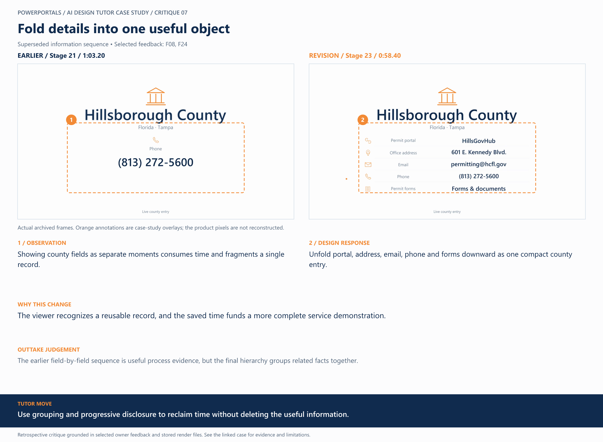

# 07 / Fold details into one useful object

**Earlier treatment:** Superseded information sequence. **Review type:** retrospective design critique.

| Source | Earlier | Revision |
|---|---|---|
| Stage | 21 | 23 |
| Frame time | 1:03.20 | 0:58.40 |
| Unannotated frame | [View](../../assets/frames/07-before.jpg) | [View](../../assets/frames/07-after.jpg) |
| Extraction provenance | [Record](../../assets/frames/07-before.jpg.json) | [Record](../../assets/frames/07-after.jpg.json) |

## The feedback

> We also need to never show a wall of text to read, keep it TV friendly, big focus, only a few words at a time

— F08, selected project-owner feedback

> We can shorten the animation frames for the Hillsborough animation by showing all data (phone, etc) in one thing that folds out downward, similar to the animations showing the BOM list.

— F24, selected project-owner feedback

## The judgement

**Observation:** Showing county fields as separate moments consumes time and fragments a single record.

**Instruction:** Unfold portal, address, email, phone and forms downward as one compact county entry.

**Why:** The viewer recognizes a reusable record, and the saved time funds a more complete service demonstration.

**Why the earlier treatment was superseded or retained:** The earlier field-by-field sequence is useful process evidence, but the final hierarchy groups related facts together.

## What this teaches

Use grouping and progressive disclosure to reclaim time without deleting the useful information.

This is evidence of a design decision and its resulting artifact. It is not a measured conversion, comprehension or product-compatibility result. The analysis was written after production; the source frames are authentic archived extracts. Motion and sound require playback evidence rather than a still alone.

[All critiques](../critique-index.md) · [Showcase overview](../../README.md)
