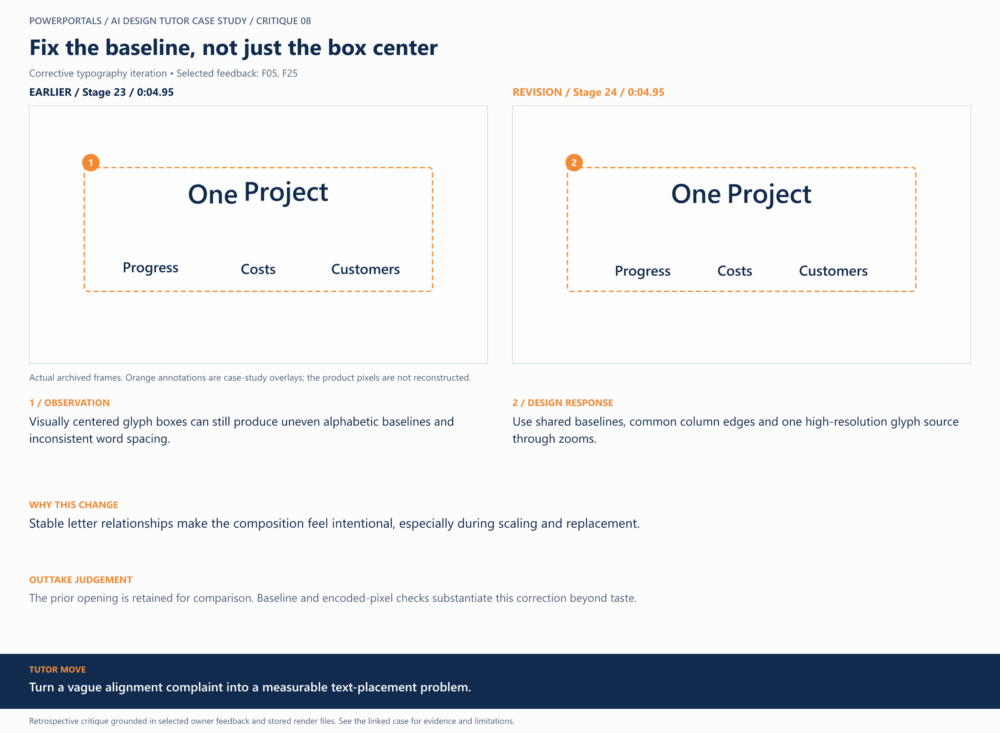

# 08 / Fix the baseline, not just the box center

**Earlier treatment:** Corrective typography iteration. **Review type:** retrospective design critique.

| Source | Earlier | Revision |
|---|---|---|
| Stage | 23 | 24 |
| Frame time | 0:04.95 | 0:04.95 |
| Unannotated frame | [View](../../assets/frames/08-before.jpg) | [View](../../assets/frames/08-after.jpg) |
| Extraction provenance | [Record](../../assets/frames/08-before.jpg.json) | [Record](../../assets/frames/08-after.jpg.json) |

## The feedback

> some text centering on the WordPress and Zoho portion of the video was not well centered

— F05, selected project-owner feedback

> Now let's run through an animation and alignment on text and make sure our animation transitions are smooth and timely

— F25, selected project-owner feedback

## The judgement

**Observation:** Visually centered glyph boxes can still produce uneven alphabetic baselines and inconsistent word spacing.

**Instruction:** Use shared baselines, common column edges and one high-resolution glyph source through zooms.

**Why:** Stable letter relationships make the composition feel intentional, especially during scaling and replacement.

**Why the earlier treatment was superseded or retained:** The prior opening is retained for comparison. Baseline and encoded-pixel checks substantiate this correction beyond taste.

## What this teaches

Turn a vague alignment complaint into a measurable text-placement problem.

This is evidence of a design decision and its resulting artifact. It is not a measured conversion, comprehension or product-compatibility result. The analysis was written after production; the source frames are authentic archived extracts. Motion and sound require playback evidence rather than a still alone.

[All critiques](../critique-index.md) · [Showcase overview](../../README.md)
