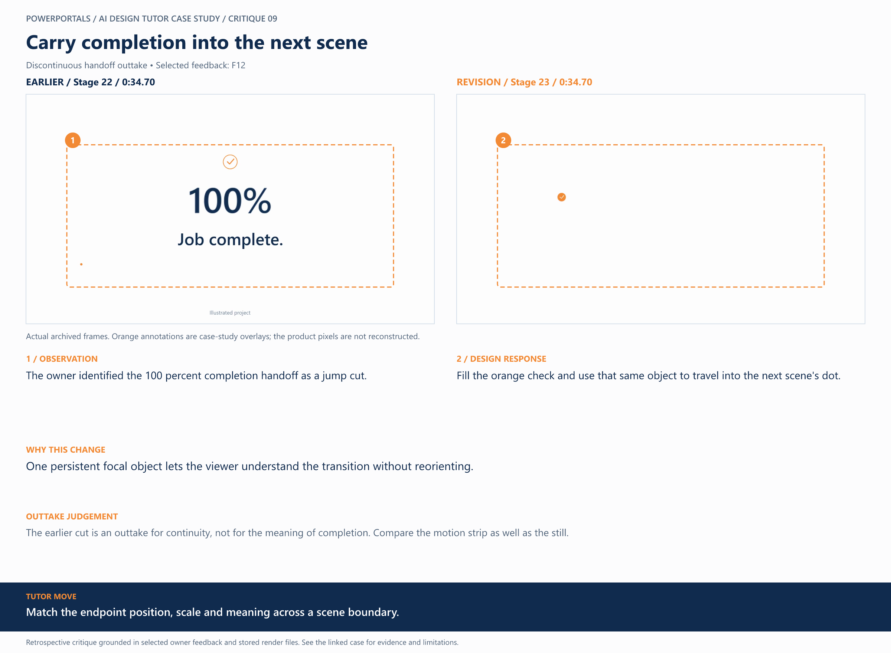
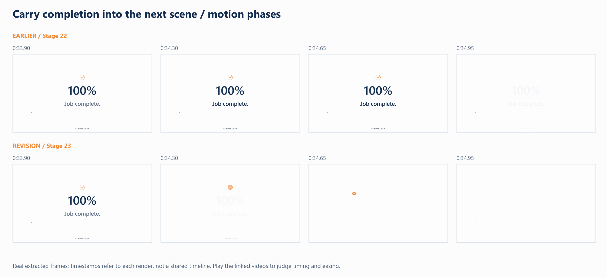
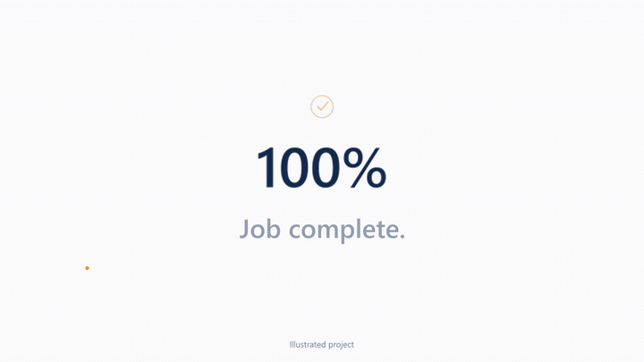

# 09 / Carry completion into the next scene

**Earlier treatment:** Discontinuous handoff outtake. **Review type:** retrospective design critique.

| Source | Earlier | Revision |
|---|---|---|
| Stage | 22 | 23 |
| Frame time | 0:34.70 | 0:34.70 |
| Unannotated frame | [View](../../assets/frames/09-before.jpg) | [View](../../assets/frames/09-after.jpg) |
| Extraction provenance | [Record](../../assets/frames/09-before.jpg.json) | [Record](../../assets/frames/09-after.jpg.json) |

## The feedback

> the 100% job complete is a jump cut, I would like to use the orange check mark icon, fill it in, and have it be the transition focal point

— F12, selected project-owner feedback

## The judgement

**Observation:** The owner identified the 100 percent completion handoff as a jump cut.

**Instruction:** Fill the orange check and use that same object to travel into the next scene's dot.

**Why:** One persistent focal object lets the viewer understand the transition without reorienting.

**Why the earlier treatment was superseded or retained:** The earlier cut is an outtake for continuity, not for the meaning of completion. Compare the motion strip as well as the still.

## What this teaches

Match the endpoint position, scale and meaning across a scene boundary.

This is evidence of a design decision and its resulting artifact. It is not a measured conversion, comprehension or product-compatibility result. The analysis was written after production; the source frames are authentic archived extracts. Motion and sound require playback evidence rather than a still alone.

## Motion evidence

Four-phase strips show the visual states, not the speed by themselves. Timestamps refer to each source version; retimed versions can show the same narrative event at different global times.

Silent, reduced-size excerpt extracted from the archived render.

[All critiques](../critique-index.md) · [Showcase overview](../../README.md)
