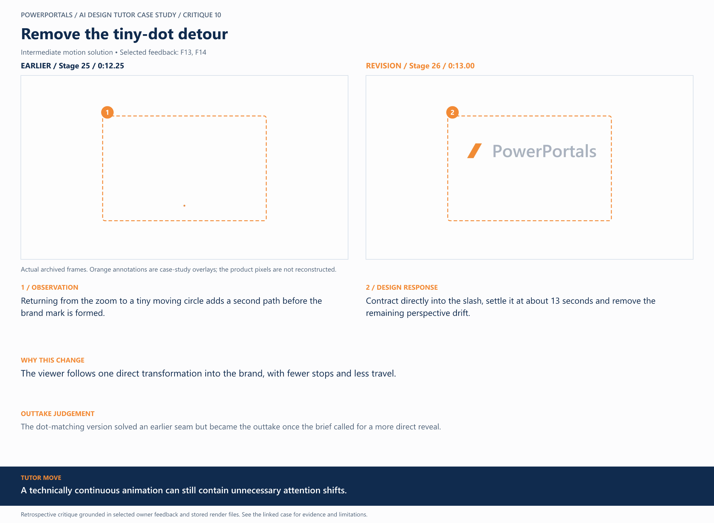
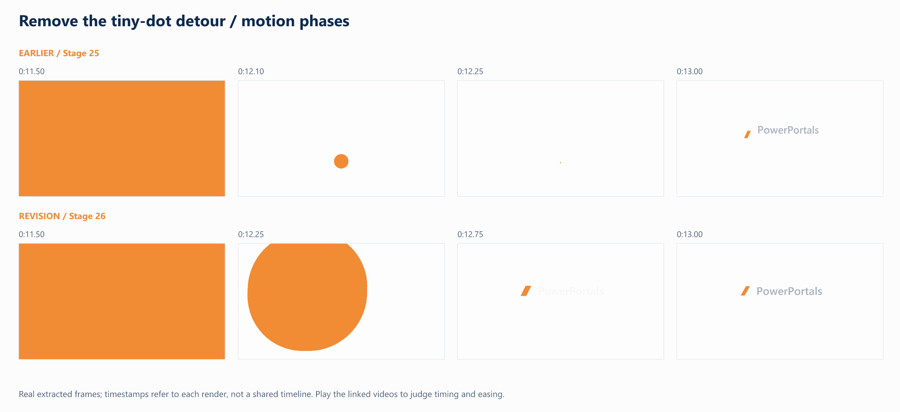
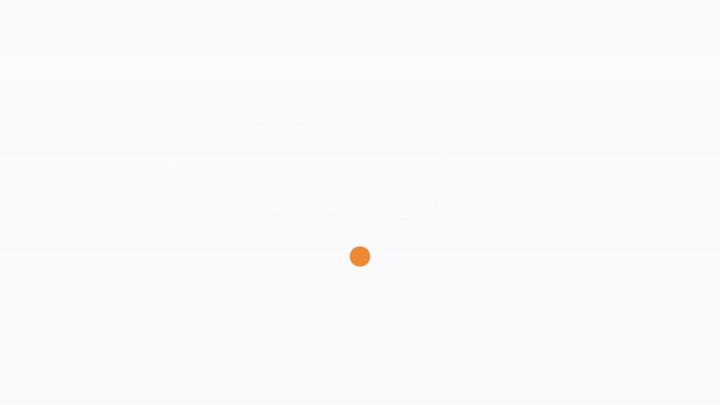

# 10 / Remove the tiny-dot detour

**Earlier treatment:** Intermediate motion solution. **Review type:** retrospective design critique.

| Source | Earlier | Revision |
|---|---|---|
| Stage | 25 | 26 |
| Frame time | 0:12.25 | 0:13.00 |
| Unannotated frame | [View](../../assets/frames/10-before.jpg) | [View](../../assets/frames/10-after.jpg) |
| Extraction provenance | [Record](../../assets/frames/10-before.jpg.json) | [Record](../../assets/frames/10-after.jpg.json) |

## The feedback

> Between ~0:22 - ~0:31 that layout of task assignment and task animation can be sped up.

— F13, selected project-owner feedback

> Instead of it becoming a small orange circle, I want it to shrink down and take the shape of the PowerPortals orange slash

— F14, selected project-owner feedback

## The judgement

**Observation:** Returning from the zoom to a tiny moving circle adds a second path before the brand mark is formed.

**Instruction:** Contract directly into the slash, settle it at about 13 seconds and remove the remaining perspective drift.

**Why:** The viewer follows one direct transformation into the brand, with fewer stops and less travel.

**Why the earlier treatment was superseded or retained:** The dot-matching version solved an earlier seam but became the outtake once the brief called for a more direct reveal.

## What this teaches

A technically continuous animation can still contain unnecessary attention shifts.

This is evidence of a design decision and its resulting artifact. It is not a measured conversion, comprehension or product-compatibility result. The analysis was written after production; the source frames are authentic archived extracts. Motion and sound require playback evidence rather than a still alone.

## Motion evidence

Four-phase strips show the visual states, not the speed by themselves. Timestamps refer to each source version; retimed versions can show the same narrative event at different global times.

Silent, reduced-size excerpt extracted from the archived render.

[All critiques](../critique-index.md) · [Showcase overview](../../README.md)
