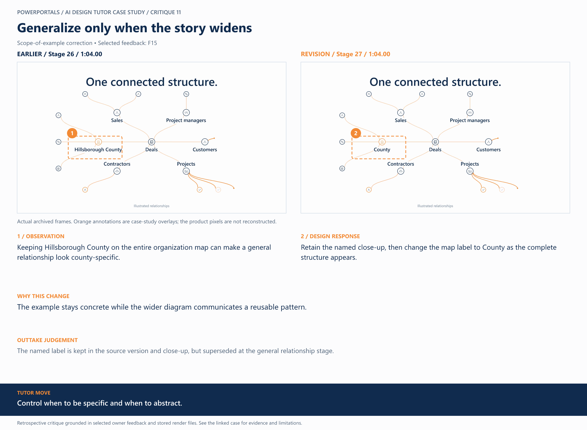

# 11 / Generalize only when the story widens

**Earlier treatment:** Scope-of-example correction. **Review type:** retrospective design critique.

| Source | Earlier | Revision |
|---|---|---|
| Stage | 26 | 27 |
| Frame time | 1:04.00 | 1:04.00 |
| Unannotated frame | [View](../../assets/frames/11-before.jpg) | [View](../../assets/frames/11-after.jpg) |
| Extraction provenance | [Record](../../assets/frames/11-before.jpg.json) | [Record](../../assets/frames/11-after.jpg.json) |

## The feedback

> I would like to make it so it says just "County" when it hits this stage

— F15, selected project-owner feedback

## The judgement

**Observation:** Keeping Hillsborough County on the entire organization map can make a general relationship look county-specific.

**Instruction:** Retain the named close-up, then change the map label to County as the complete structure appears.

**Why:** The example stays concrete while the wider diagram communicates a reusable pattern.

**Why the earlier treatment was superseded or retained:** The named label is kept in the source version and close-up, but superseded at the general relationship stage.

## What this teaches

Control when to be specific and when to abstract.

This is evidence of a design decision and its resulting artifact. It is not a measured conversion, comprehension or product-compatibility result. The analysis was written after production; the source frames are authentic archived extracts. Motion and sound require playback evidence rather than a still alone.

[All critiques](../critique-index.md) · [Showcase overview](../../README.md)
