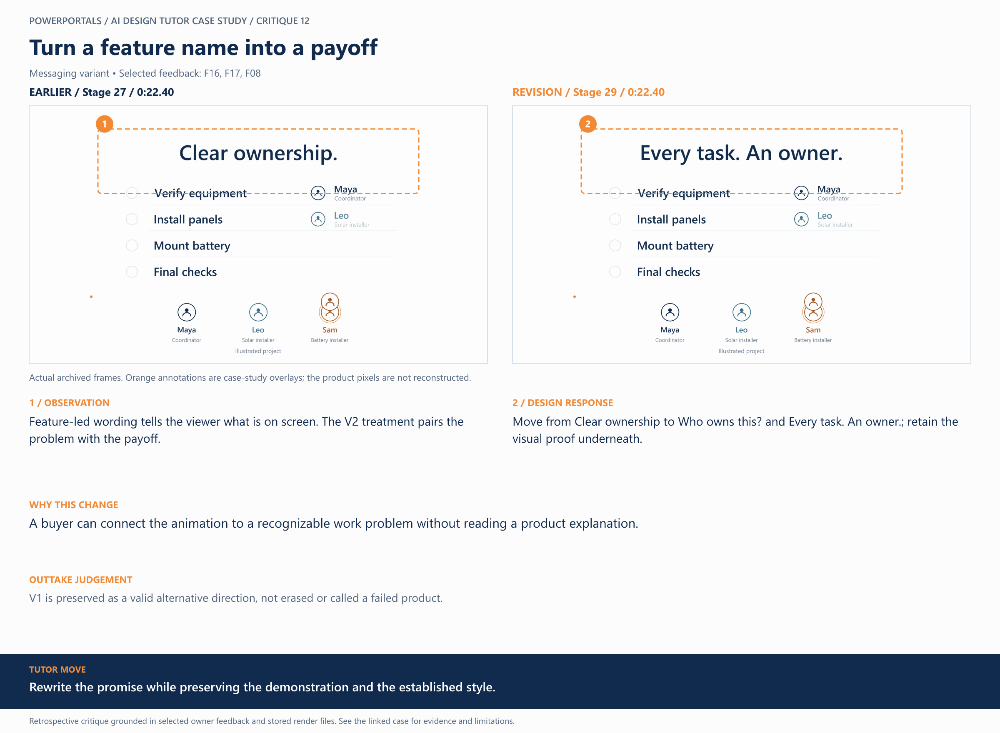

# 12 / Turn a feature name into a payoff

**Earlier treatment:** Messaging variant. **Review type:** retrospective design critique.

| Source | Earlier | Revision |
|---|---|---|
| Stage | 27 | 29 |
| Frame time | 0:22.40 | 0:22.40 |
| Unannotated frame | [View](../../assets/frames/12-before.jpg) | [View](../../assets/frames/12-after.jpg) |
| Extraction provenance | [Record](../../assets/frames/12-before.jpg.json) | [Record](../../assets/frames/12-after.jpg.json) |

## The feedback

> make the language/words on the slides problem to solution, benefit driven

— F16, selected project-owner feedback

> Make this as a v2 of the video, same everything, different filename

— F17, selected project-owner feedback

> We also need to never show a wall of text to read, keep it TV friendly, big focus, only a few words at a time

— F08, selected project-owner feedback

## The judgement

**Observation:** Feature-led wording tells the viewer what is on screen. The V2 treatment pairs the problem with the payoff.

**Instruction:** Move from Clear ownership to Who owns this? and Every task. An owner.; retain the visual proof underneath.

**Why:** A buyer can connect the animation to a recognizable work problem without reading a product explanation.

**Why the earlier treatment was superseded or retained:** V1 is preserved as a valid alternative direction, not erased or called a failed product.

## What this teaches

Rewrite the promise while preserving the demonstration and the established style.

This is evidence of a design decision and its resulting artifact. It is not a measured conversion, comprehension or product-compatibility result. The analysis was written after production; the source frames are authentic archived extracts. Motion and sound require playback evidence rather than a still alone.

[All critiques](../critique-index.md) · [Showcase overview](../../README.md)
