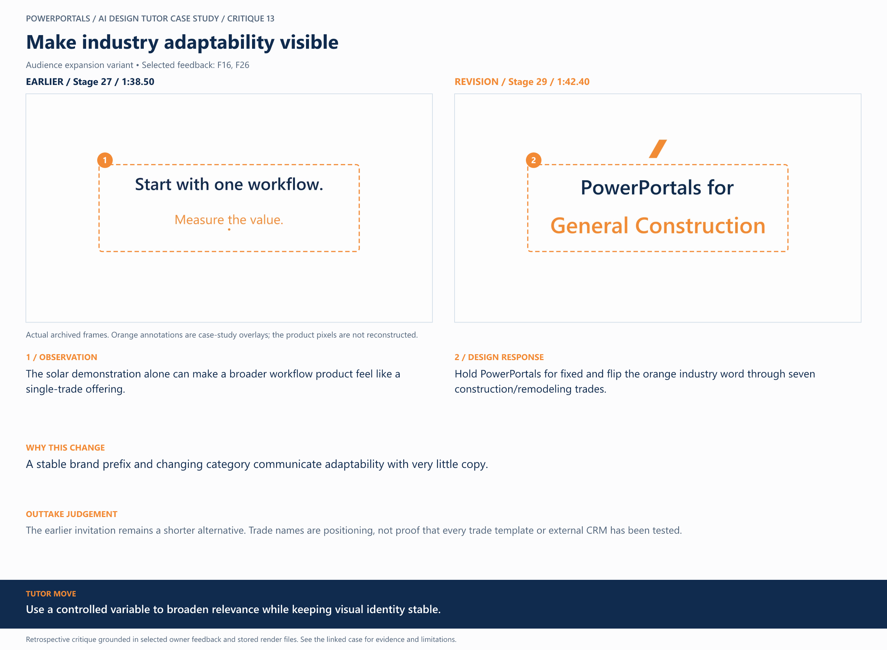

# 13 / Make industry adaptability visible

**Earlier treatment:** Audience expansion variant. **Review type:** retrospective design critique.

| Source | Earlier | Revision |
|---|---|---|
| Stage | 27 | 29 |
| Frame time | 1:38.50 | 1:42.40 |
| Unannotated frame | [View](../../assets/frames/13-before.jpg) | [View](../../assets/frames/13-after.jpg) |
| Extraction provenance | [Record](../../assets/frames/13-before.jpg.json) | [Record](../../assets/frames/13-after.jpg.json) |

## The feedback

> make the language/words on the slides problem to solution, benefit driven

— F16, selected project-owner feedback

> and have Solar in Orange, and have it flip through different industries it is ready to serve

— F26, selected project-owner feedback

## The judgement

**Observation:** The solar demonstration alone can make a broader workflow product feel like a single-trade offering.

**Instruction:** Hold PowerPortals for fixed and flip the orange industry word through seven construction/remodeling trades.

**Why:** A stable brand prefix and changing category communicate adaptability with very little copy.

**Why the earlier treatment was superseded or retained:** The earlier invitation remains a shorter alternative. Trade names are positioning, not proof that every trade template or external CRM has been tested.

## What this teaches

Use a controlled variable to broaden relevance while keeping visual identity stable.

This is evidence of a design decision and its resulting artifact. It is not a measured conversion, comprehension or product-compatibility result. The analysis was written after production; the source frames are authentic archived extracts. Motion and sound require playback evidence rather than a still alone.

Silent, reduced-size excerpt extracted from the archived render.

[All critiques](../critique-index.md) · [Showcase overview](../../README.md)
