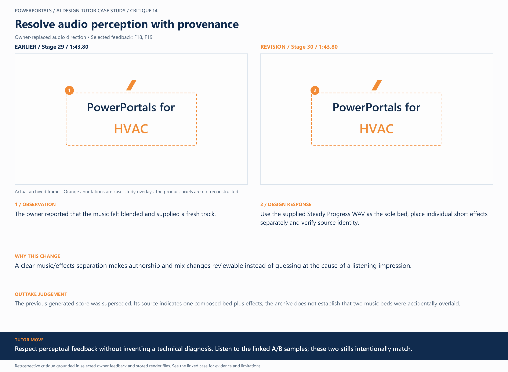

# 14 / Resolve audio perception with provenance

**Earlier treatment:** Owner-replaced audio direction. **Review type:** retrospective design critique.

| Source | Earlier | Revision |
|---|---|---|
| Stage | 29 | 30 |
| Frame time | 1:43.80 | 1:43.80 |
| Unannotated frame | [View](../../assets/frames/14-before.jpg) | [View](../../assets/frames/14-after.jpg) |
| Extraction provenance | [Record](../../assets/frames/14-before.jpg.json) | [Record](../../assets/frames/14-after.jpg.json) |

## The feedback

> It feels like the music may have gotten blended.

— F18, selected project-owner feedback

> I am providing a fresh Mp3 track to use, and then you place the individual sound effects. WAV or MP3, it is the same song.

— F19, selected project-owner feedback

## The judgement

**Observation:** The owner reported that the music felt blended and supplied a fresh track.

**Instruction:** Use the supplied Steady Progress WAV as the sole bed, place individual short effects separately and verify source identity.

**Why:** A clear music/effects separation makes authorship and mix changes reviewable instead of guessing at the cause of a listening impression.

**Why the earlier treatment was superseded or retained:** The previous generated score was superseded. Its source indicates one composed bed plus effects; the archive does not establish that two music beds were accidentally overlaid.

## What this teaches

Respect perceptual feedback without inventing a technical diagnosis. These two stills intentionally match; listen to the final film for the selected synchronized sound.

This is evidence of a design decision and its resulting artifact. It is not a measured conversion, comprehension or product-compatibility result. The analysis was written after production; the source frames are authentic archived extracts. Motion and sound require playback evidence rather than a still alone.

## Review the selected soundtrack

[Watch the selected final film](../../media/versions/31.mp4) to hear the owner-produced soundtrack with individual effects. Standalone audio comparisons are excluded under this repository’s publication policy.

The images intentionally match: a still cannot prove an audio difference. The earlier score was superseded following a listening judgement; the archive does not establish an accidental two-music-bed fault. The replacement used the supplied WAV as its sole music bed with separate effects.

[All critiques](../critique-index.md) · [Showcase overview](../../README.md)
