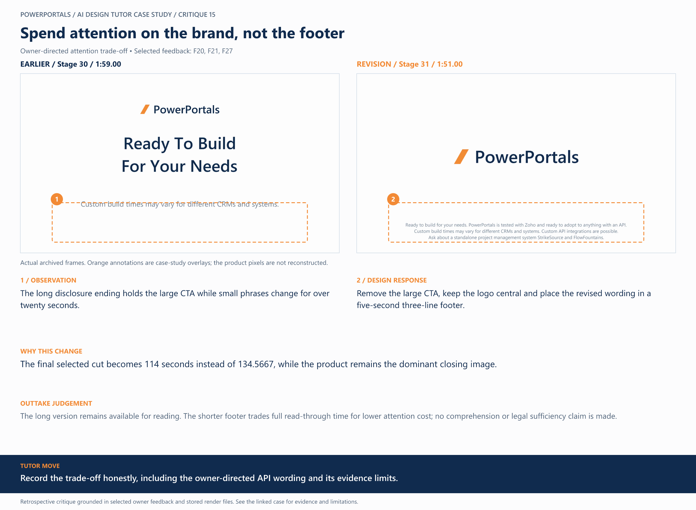

# 15 / Spend attention on the brand, not the footer

**Earlier treatment:** Owner-directed attention trade-off. **Review type:** retrospective design critique.

| Source | Earlier | Revision |
|---|---|---|
| Stage | 30 | 31 |
| Frame time | 1:59.00 | 1:51.00 |
| Unannotated frame | [View](../../assets/frames/15-before.jpg) | [View](../../assets/frames/15-after.jpg) |
| Extraction provenance | [Record](../../assets/frames/15-before.jpg.json) | [Record](../../assets/frames/15-after.jpg.json) |

## The feedback

> Leave it on screen for about 5 seconds and then transition out.

— F20, selected project-owner feedback

> let's just leave it at "ready to adopt to anything with an API" so it's more open ended.

— F21, selected project-owner feedback

> Remove "Ready to build for your needs" as a disclaimer large title text, and put it in the small text.

— F27, selected project-owner feedback

## The judgement

**Observation:** The long disclosure ending holds the large CTA while small phrases change for over twenty seconds.

**Instruction:** Remove the large CTA, keep the logo central and place the revised wording in a five-second three-line footer.

**Why:** The final selected cut becomes 114 seconds instead of 134.5667, while the product remains the dominant closing image.

**Why the earlier treatment was superseded or retained:** The long version remains available for reading. The shorter footer trades full read-through time for lower attention cost; no comprehension or legal sufficiency claim is made.

## What this teaches

Record the trade-off honestly, including the owner-directed API wording and its evidence limits.

This is evidence of a design decision and its resulting artifact. It is not a measured conversion, comprehension or product-compatibility result. The analysis was written after production; the source frames are authentic archived extracts. Motion and sound require playback evidence rather than a still alone.

[All critiques](../critique-index.md) · [Showcase overview](../../README.md)
