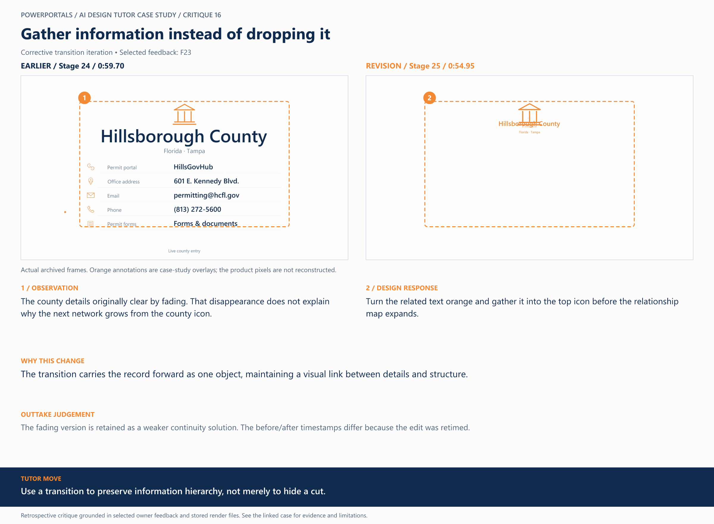
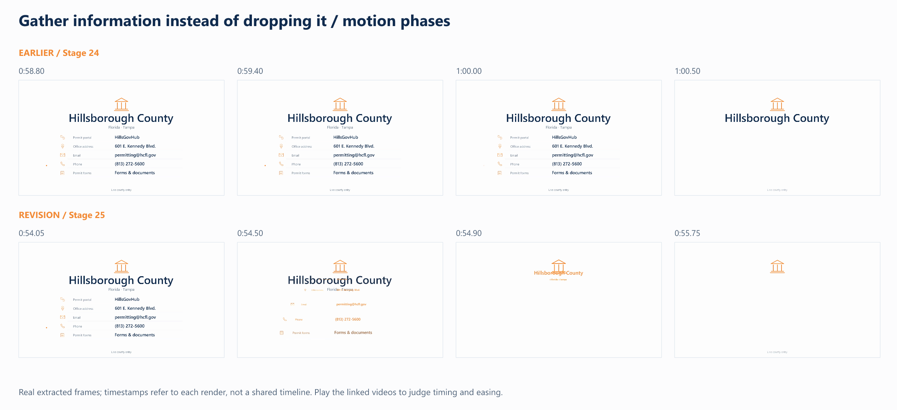

# 16 / Gather information instead of dropping it

**Earlier treatment:** Corrective transition iteration. **Review type:** retrospective design critique.

| Source | Earlier | Revision |
|---|---|---|
| Stage | 24 | 25 |
| Frame time | 0:59.70 | 0:54.95 |
| Unannotated frame | [View](../../assets/frames/16-before.jpg) | [View](../../assets/frames/16-after.jpg) |
| Extraction provenance | [Record](../../assets/frames/16-before.jpg.json) | [Record](../../assets/frames/16-after.jpg.json) |

## The feedback

> At ~0:58 to ~1:00 mark for the animation of the text that currently fades out, I would like it to merge into the top icon and change orange on it's way to the orange icon along with the rest of the words to complete the transition, keep only what keeps the animation transition smooth here.

— F23, selected project-owner feedback

## The judgement

**Observation:** The county details originally clear by fading. That disappearance does not explain why the next network grows from the county icon.

**Instruction:** Turn the related text orange and gather it into the top icon before the relationship map expands.

**Why:** The transition carries the record forward as one object, maintaining a visual link between details and structure.

**Why the earlier treatment was superseded or retained:** The fading version is retained as a weaker continuity solution. The before/after timestamps differ because the edit was retimed.

## What this teaches

Use a transition to preserve information hierarchy, not merely to hide a cut.

This is evidence of a design decision and its resulting artifact. It is not a measured conversion, comprehension or product-compatibility result. The analysis was written after production; the source frames are authentic archived extracts. Motion and sound require playback evidence rather than a still alone.

## Motion evidence

Four-phase strips show the visual states, not the speed by themselves. Timestamps refer to each source version; retimed versions can show the same narrative event at different global times.

[All critiques](../critique-index.md) · [Showcase overview](../../README.md)
