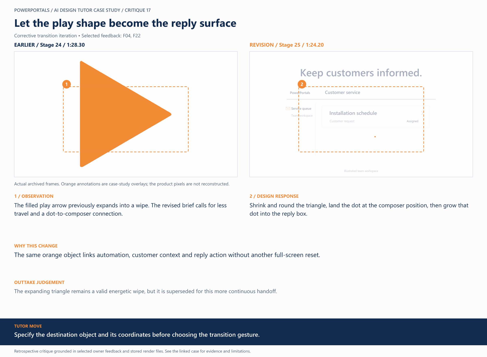
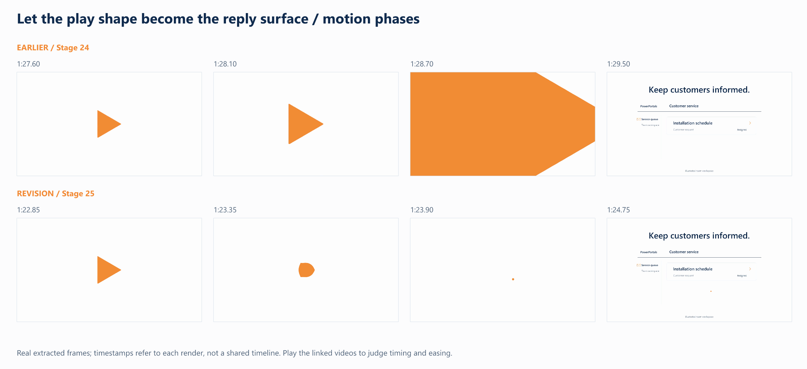

# 17 / Let the play shape become the reply surface

**Earlier treatment:** Corrective transition iteration. **Review type:** retrospective design critique.

| Source | Earlier | Revision |
|---|---|---|
| Stage | 24 | 25 |
| Frame time | 1:28.30 | 1:24.20 |
| Unannotated frame | [View](../../assets/frames/17-before.jpg) | [View](../../assets/frames/17-after.jpg) |
| Extraction provenance | [Record](../../assets/frames/17-before.jpg.json) | [Record](../../assets/frames/17-after.jpg.json) |

## The feedback

> The next polish will need to focus exclusively on the movements and animation smoothness

— F04, selected project-owner feedback

> Between ~1:27 - ~1:29 the triangle should shrink back down and round back out into an orange dot and land on an orange dot space. Animate the dot to become the reply box, and then follow through with the remaining orange text box shrink animation back out to a dot.

— F22, selected project-owner feedback

## The judgement

**Observation:** The filled play arrow previously expands into a wipe. The revised brief calls for less travel and a dot-to-composer connection.

**Instruction:** Shrink and round the triangle, land the dot at the composer position, then grow that dot into the reply box.

**Why:** The same orange object links automation, customer context and reply action without another full-screen reset.

**Why the earlier treatment was superseded or retained:** The expanding triangle remains a valid energetic wipe, but it is superseded for this more continuous handoff.

## What this teaches

Specify the destination object and its coordinates before choosing the transition gesture.

This is evidence of a design decision and its resulting artifact. It is not a measured conversion, comprehension or product-compatibility result. The analysis was written after production; the source frames are authentic archived extracts. Motion and sound require playback evidence rather than a still alone.

## Motion evidence

Four-phase strips show the visual states, not the speed by themselves. Timestamps refer to each source version; retimed versions can show the same narrative event at different global times.

[All critiques](../critique-index.md) · [Showcase overview](../../README.md)
